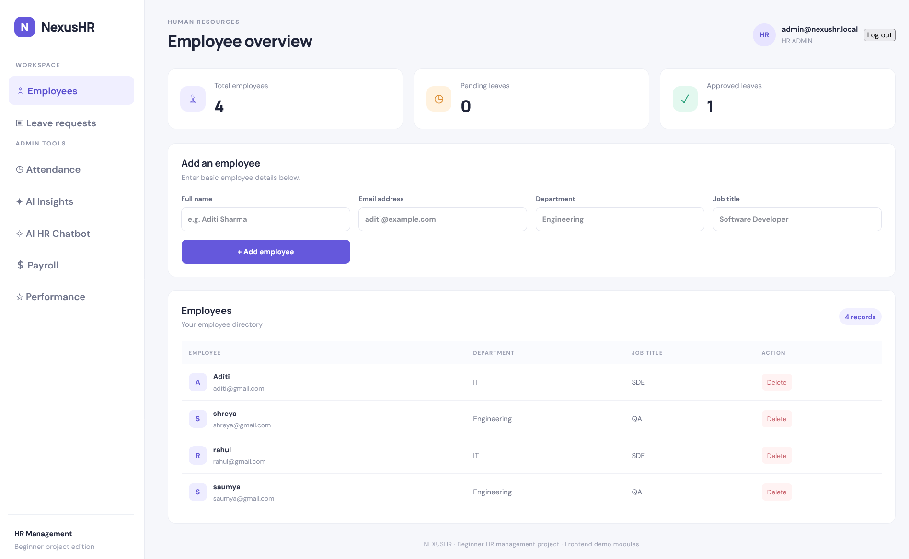
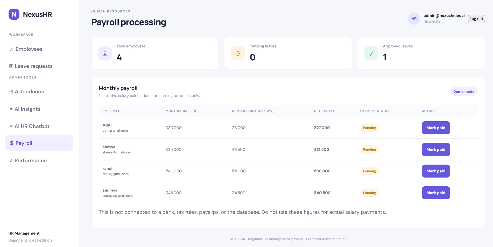
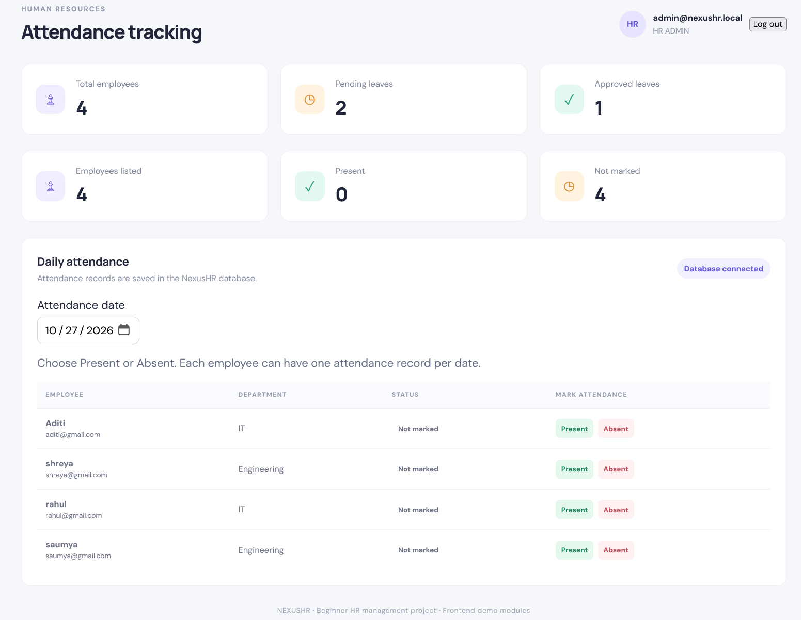
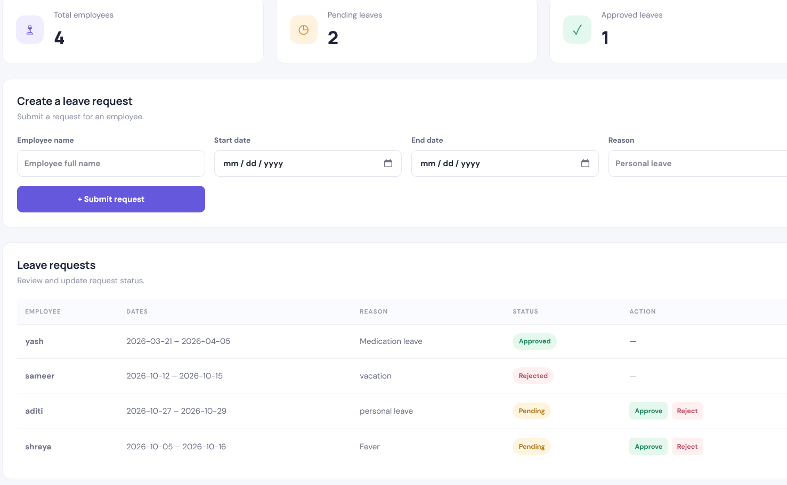
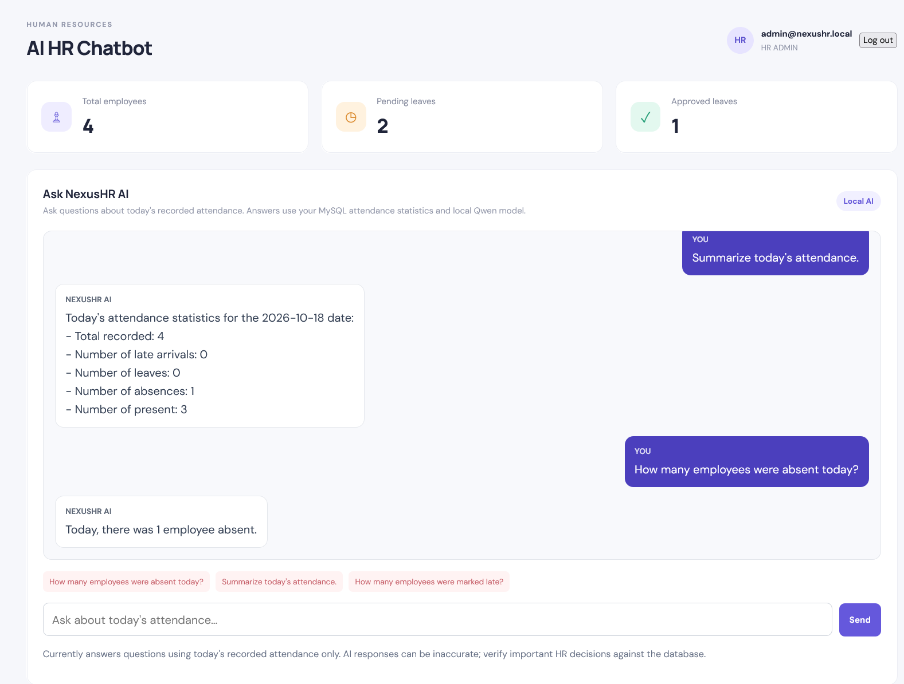

# NexusHR — AI-Powered Human Resource Management Systems

NexusHR is a full-stack Human Resource Management System (HRMS) designed to simplify employee management, attendance tracking, leave management, and HR operations with AI-powered workforce insights and an HR chatbot.

The project combines a **Spring Boot REST API**, a **React and TypeScript frontend**, **MySQL** for persistent storage, and **Ollama** for locally running AI models.

---

## 📸 Project Screenshots

> Replace the placeholders below with screenshots of your running application. Save images in the `assets/` folder and use the filenames shown.

### 1. Dashboard

<!-- Replace this placeholder with:  -->


### 2. Employee Management

<!-- Replace this placeholder with:  -->


### 3. Attendance Management

<!-- Replace this placeholder with:  -->


### 4. Leave Management

<!-- Replace this placeholder with:  -->


### 5. AI Workforce Insights

<!-- Replace this placeholder with:  -->


### 6. AI HR Chatbot

<!-- Replace this placeholder with:  -->


---

## ✨ Features

### Employee Management
- Manage employee records and information.
- Support employee account creation and access.
- Store employee-related data in MySQL.

### Attendance Management
- Record employee attendance by date.
- Track present and absent statuses.
- Retrieve attendance records from the database.

### Leave Management
- Manage employee leave requests.
- Support HR workflows for reviewing leave requests.

### Authentication and Security
- JWT-based authentication.
- Role-based access for HR administrators and employees.
- Protected backend endpoints.

### AI Workforce Insights
- Generate workforce summaries using stored application data.
- Review attendance-related statistics.
- Use a locally running AI model to help explain workforce information.

### AI HR Chatbot
- Provide a chat interface for HR-related questions.
- Connect the backend to a local Ollama model.
- Generate AI responses without relying on a hosted AI API.

---

## 🛠️ Technology Stack

| Component | Technology |
|---|---|
| Frontend | React, TypeScript, Vite |
| Backend | Java 21, Spring Boot |
| API | REST |
| Database | MySQL |
| Authentication | Spring Security, JWT |
| AI Integration | Ollama, Qwen 2.5 1.5B Instruct |
| Development Tools | VS Code, MySQL Workbench, Maven, npm |

---

## 🏗️ Project Structure

```text
NexusHR/
├── backend/
│   ├── src/
│   │   └── main/
│   │       ├── java/com/nexushr/
│   │       │   ├── ai/
│   │       │   ├── attendance/
│   │       │   ├── controller/
│   │       │   ├── dto/
│   │       │   ├── employee/
│   │       │   ├── leave/
│   │       │   ├── model/
│   │       │   ├── repository/
│   │       │   └── security/
│   │       └── resources/
│   │           └── application.example.properties
│   └── pom.xml
├── frontend/
│   ├── src/
│   │   ├── App.tsx
│   │   ├── main.tsx
│   │   └── style.css
│   ├── index.html
│   ├── package.json
│   └── vite.config.ts
├── assets/
│   └── (add project screenshots here)
├── .gitignore
└── README.md
```

---

## ⚙️ Prerequisites

Install the following before running the application:

- Java Development Kit (JDK) 21
- Maven, or use the Maven wrapper if one is added to the project
- Node.js and npm
- MySQL Server
- Ollama

---

## 🚀 Installation and Setup

### 1. Clone the repository

```bash
git clone https://github.com/RedPanda2468/NexusHR.git
cd NexusHR
```

### 2. Configure the MySQL database

Start MySQL and create the database:

```sql
CREATE DATABASE nexushr;
```

### 3. Configure the backend

Navigate to the backend directory:

```bash
cd backend
```

Copy the example configuration to a local configuration file.

**Windows PowerShell:**

```powershell
Copy-Item .\src\main\resources\application.example.properties .\src\main\resources\application.properties
```

Open `src/main/resources/application.properties` and configure your database username, password, and JWT secret.

The example file uses environment variables:

```properties
spring.datasource.username=${DB_USERNAME}
spring.datasource.password=${DB_PASSWORD}
app.jwt.secret=${JWT_SECRET}
```

Set these variables in the same PowerShell terminal before starting Spring Boot. Replace the sample values with your own local credentials and a strong, randomly generated JWT secret.

```powershell
$env:DB_USERNAME = "your_mysql_username"
$env:DB_PASSWORD = "your_mysql_password"
$env:JWT_SECRET = "replace_with_a_long_random_secret"
```

Keep your real credentials private. Do not commit `application.properties` or share your secrets publicly.

### 4. Start the backend

From the `backend` directory, run:

```powershell
mvn spring-boot:run
```

The backend should start at:

```text
http://localhost:8080
```

Keep this terminal running.

### 5. Set up the AI model

Install Ollama, then download the model used by the project:

```powershell
ollama pull qwen2.5:1.5b-instruct
```

Start Ollama and verify that the model is available:

```powershell
ollama list
```

The backend AI integration is configured to use the local Ollama API at `http://localhost:11434`. Ensure Ollama is running before using the AI features.

### 6. Start the frontend

Open a **second terminal** and navigate to the frontend directory from the project root:

```powershell
cd frontend
npm install
npm run dev
```

Open the local development URL shown in the terminal. By default, Vite uses:

```text
http://localhost:5173
```

The frontend and backend must both be running to use the application.

---

## 🔐 Security Notes

- Never commit database passwords, JWT secrets, access tokens, or `.env` files.
- Use strong, unique secrets for local and deployed environments.
- The example configuration is a template; configure your own credentials before running the project.
- Local development credentials should not be used in production.
- Review and test authentication, authorization, and data validation before deploying the application.

---

## 🗺️ Future Improvements

Potential future enhancements include:

- Payroll management and salary calculations.
- Employee performance evaluation.
- Machine-learning-based employee attrition prediction.
- Real-time notifications.
- Advanced analytics and reporting.
- Automated testing and CI/CD pipelines.
- Monitoring with Prometheus and Grafana.
- Cloud deployment.

These are planned enhancements and should not be considered implemented features unless they are added to the application.

---

## 🎯 Project Goal

NexusHR aims to demonstrate how modern web technologies, secure backend APIs, relational databases, and locally hosted AI models can work together to support common HR workflows.

---

## 👨‍💻 Repository

**GitHub:** https://github.com/RedPanda2468/NexusHR

**Status:** Under development

